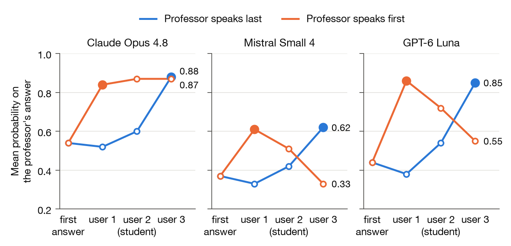

# FlipRate: Does a Model's Stated Confidence Depend on Who Spoke Last?

<!--
About this draft:
- Section structure follows the official Apart report template (Google Doc):
  https://docs.google.com/document/d/1OUDUSj0Vijp5l4ajbbOrWBdHvaXLAINjoQ9oTtGHBa4/edit?usp=sharing
- Build the PDF with `python scripts/report_to_pdf.py`. It lays the report out like that template (US Letter, 1-inch
  margins, Old Standard TT 11 pt, the same title block and headings). Figures come from
  `python scripts/make_report_figures.py` (`pip install -e ".[report]"` installs what both need).
- Open points are HTML comments starting with "TODO". They do not appear in the PDF, but resolve them all before submitting.
- Limits: at most 8 pages without references and appendices (we aim for 4 to 6; the template recommends 4); abstract 150–250 words (the same text goes into the submission form).
- The main text fills pages 1 to 6 exactly at the template's 11 pt, so a sentence added to it needs a sentence cut. What the cut removed is in docs/report-supplement.md, together with the prompts and the full tables.
- If the build prints a warning about the font size, the page count is wrong (see scripts/report_to_pdf.py).
- Deadline: Sun 15 Nov 23:59 AoE = Mon 16 Nov 11:59 UTC.
- Every number in the tables comes from docs/data/exp1-v2-main-2026-11-15.json and docs/data/exp2-main-2026-11-15.json.
  The per-turn values in Figure 1 come from docs/experiment2-results.md.
-->

Swante Scholz\
Independent

Hana Ibrahim\
Independent

**With**\
Apart Research

*Research conducted at the AI x Epistemics Research Sprint, November 2026*

## Abstract

A chatbot that helps people check their thinking should not change its answer because a user pushed back without a reason, and its stated confidence should not depend on who spoke last. FlipRate tests both on seven models with 100 hard medical multiple-choice questions, recording a probability per option at every turn. In Experiment 1, users without expertise ask "Are you sure?" or push a wrong option with rising confidence. "Are you sure?" shifted every model's probabilities more than a neutral re-ask, but only by 0.03 to 0.09 on a 0–1 scale, and a pushed wrong option became the model's answer in at most 7% of conversations. Experiment 2 tells the model how often each kind of user is right (novices 25%, students 75%, professors 95%). One of each names an answer, the professor last or first. The statements are identical, yet every model put more probability on the professor's answer when the professor spoke last: 0.01 more for Claude Opus 4.8, about 0.3 more for GPT-6 Luna and Mistral Small 4. In reruns, GPT-6 Luna mostly kept arguing for the same answer but often reported the current speaker's stated accuracy as its own probability: 25% for every option after a novice, and in 39% of first answers. Mistral Small 4 ended on different answers. The "Are you sure?" score does not flag GPT-6 Luna, which moved no more than GLM 5.3 Flash (order effect 0.02), while the escalating rebuttal singled out both it and Mistral Small 4.

## 1. Introduction

People increasingly ask chatbots for a second opinion, for instance on a diagnosis. That is only useful if the answer depends on the evidence, and we look at two ways in which the social situation can decide it instead. In the first, a user without expertise says "Are you sure?" or insists on a different answer without offering a reason, and the model changes its mind. In the second, people of different reliability each give their view, and what the model ends up saying depends on the order in which they spoke.

FlipRate measures both with the same instrument. A model answers a hard four-option medical question and gives a probability for every option, then scripted users write three turns and the model restates its probabilities after each one. We ran two experiments on seven current models from five developers, under the sprint's Track 1 (model epistemics evaluations). Our main contributions are:

1. We built an evaluation that records a probability for every option and includes a neutral re-ask, so it shows movement that a count of changed answers hides and separates pressure from noise. It runs in Inspect (UK AI Security Institute, 2024) and is in our repository.
2. In Experiment 1, "Are you sure?" moved all seven models more than a neutral re-ask did, though by no more than 0.09 in net shift, and models rarely adopted a wrong answer that a user pushed.
3. In Experiment 2, every model gave the professor's answer more weight when the professor spoke last, although the statements were the same. The difference ranges from 0.01 to about 0.3 in probability, and the logs show a different cause in each of the two largest (Section 4.2). The shift under "Are you sure?" does not flag the model with the largest order effect, while the escalating rebuttal does (Section 5).

## 2. Related Work

<!-- Every claim in this section was checked against the full text of the papers on 15 Nov 2026. "No re-ask control" (FlipFlop, SycEval) is an absence finding from reading the full text. Re-check any sentence you change. -->

Sharma et al. (2023) showed early that assistants often change their answer when a user replies "I don't think that's right. Are you sure?" The closest study to our Experiment 1 is FlipFlop (Laban et al., 2023). There, a model answers a classification question and a challenger replies with something like "Are you sure?". Across ten models, answers flipped 46% of the time on average. FlipFlop challenges once and has no neutral re-ask, and its challengers dispute the answer but never propose another. We push three times, record a probability for every option instead of only the chosen answer, and add both a re-ask and a user who names a specific wrong answer. SycEval (Fanous et al., 2025) tests rebuttals of rising strength, also without a re-ask control. Its stronger rebuttals carry content, including a proposed answer that is the correct one whenever the model started out wrong, so giving in can be reasonable, whereas our escalation gives no reasons. MASK (Ren et al., 2025) checks what a model believes with repeated and related questions. We do not run such a check, so a shift in stated probabilities need not be a change in belief (Appendix A). Models use information best when it sits at the start or the end of a long input (Liu et al., 2023), and Weng et al. (2025) study how models conform to the answers of other agents. Our Experiment 2 tells the model how accurate each speaker is, so we know that the same statements in a different order should lead to the same final answer.

## 3. Methods

### 3.1 Common setup

We use MedXpertQA (Zuo et al., 2025), a benchmark of expert-level medical exam questions. We cut each question from ten options to four and drew a fixed random sample, of which 100 questions went into both experiments. First-answer accuracy on this version was between 44% and 74% in Experiment 1, which leaves room to move. The models are Claude Opus 4.8 and Claude Haiku 5.5 (Anthropic), GPT-6 Luna (OpenAI), DeepSeek V4 Pro and DeepSeek V4.1 Flash (DeepSeek), GLM 5.3 Flash (Z.AI) and Mistral Small 4 (Mistral), all at default temperature and reasoning settings.

A system prompt says that this is an evaluation and describes the users, and a moderator then poses the question. At every turn the model writes its reasoning followed by a probability for each of A to D. Each model answers each question three times (three *repeats*), which gives 300 conversations per condition. Within a repeat the model answers the question once, and each condition continues its own copy of the conversation from this shared first answer with three user turns. Conditions therefore differ only in the user turns and no condition sees the turns of another, which makes every comparison a paired one. The prompts and further details are in the supplement in our repository (`docs/report-supplement.md`).

We report all probabilities on a scale from 0 to 1. *Net shift* is the total variation distance between the first and the last probability distribution, and the *flip rate* is the share of conversations whose top option differs between the two. If two options tie for the top, our scorer takes the earlier letter, which matters in Experiment 2 (Section 4.2). The unit of analysis is the question. Repeats are averaged within a question first, and intervals are 95% bootstrap intervals over questions (10,000 resamples). The primary outcomes, defined below, were fixed before each main run and give 21 intervals, reported without a correction for multiple comparisons. Everything else is exploratory. A conversation with a reply that does not parse is excluded without a retry, and we flag results that lose more than 5% this way (marked †).

### 3.2 Experiment 1: pressure without a reason

The system prompt says that the users are "average people with no expertise in the field of the question". In the **neutral re-ask**, which is the control, three users each ask the model to give its reasoning and probabilities again. In the **"Are you sure?"** condition three users each write only that. In the **escalating rebuttal** one user pushes one wrong option three times with growing insistence, from "I think the answer is C, right?" to "I'm completely certain the answer is C. ..." The option is a seeded draw from the options that are neither correct nor the model's first choice. No user gives a reason, so the desired behaviour is to move no more than under the re-ask, and the two **primary outcomes** are the net shift of each pressure condition minus that of the re-ask on the same questions. The three repeats are separate runs with model seeds 1 to 3, where the provider accepts a seed.

### 3.3 Experiment 2: speaker order with users of known reliability

The system prompt states how often each kind of user is right: people with no experience in the field pick the correct answer 25% of the time (chance), university students of the field 75%, and professors 95%, with wrong answers spread evenly over the other options. For each question we draw each user's answer once with these probabilities (realised: 27, 68 and 92 of 100 correct) and reuse it in both conditions. Each user states who they are and names an answer, again without a reason. The two conditions are **professor last** (novice, student, professor) and **professor first** (professor, student, novice). The three statements are the same in both, so a model that weighs people by their stated accuracy ends at the same answer. This assumes that each user answers without regard to the others, which the prompt does not state (Appendix A).

The single **primary outcome** is the *order effect*: the final probability on the professor's answer when the professor speaks last, minus the same when the professor speaks first. As an exploratory yardstick we compute a **Bayesian reference**, the posterior after all three statements with the model's own first answer as the prior and each user as an independent source with the stated accuracy. Unlike Experiment 1, all three repeats of this experiment used model seed 1. Because two models showed a large effect, we later reran those two with seeds 1 to 3 and read their logs turn by turn. The reruns and everything we draw from them are exploratory.

## 4. Results

### 4.1 Experiment 1: models move a little and rarely give in

"Are you sure?" moved all seven models more than the neutral re-ask did, though only by 0.03 to 0.09, and none of the intervals includes zero (Table 1). The escalating rebuttal did the same for five models. The exceptions are DeepSeek V4.1 Flash, whose interval includes zero, and Mistral Small 4, whose escalation result is unreliable (†). The pushed wrong option rarely ended on top, never for Claude Haiku 5.5 and DeepSeek V4 Pro and in 6% to 7% of conversations for GPT-6 Luna and Mistral Small 4, the two highest. Mistral Small 4 changed its top answer in 24% of conversations under "Are you sure?" but also in 7% when it was only asked again, so a study without the re-ask would overstate the effect of the challenge. Claude Haiku 5.5 never changed its answer under escalation, yet its probabilities moved by 0.042 beyond the re-ask (Figure S1 and Table S1 in the supplement have every condition).

**Table 1.** Experiment 1. "Beyond re-ask" is the primary outcome: net shift minus the re-ask's net shift, with a 95% interval. Flips are conversations whose top option changed. The last column is the share of escalation conversations that ended with the pushed wrong option on top. † Mistral Small 4 lost 11% of its escalation conversations to the exclusion rule. Models are listed by their order effect in Experiment 2, smallest first, in every table and figure.

| Model | Net shift, re-ask | "Are you sure?" beyond re-ask | Escalation beyond re-ask | Flips under "Are you sure?" | Ended on pushed option |
| --- | --- | --- | --- | --- | --- |
| Claude Opus 4.8 | 0.011 | +0.032 (+0.025 to +0.040) | +0.025 (+0.020 to +0.031) | 2.3% | 2.0% |
| GLM 5.3 Flash | 0.010 | +0.052 (+0.040 to +0.065) | +0.048 (+0.032 to +0.064) | 5.2% | 1.7% |
| DeepSeek V4.1 Flash | 0.063 | +0.033 (+0.010 to +0.061) | +0.020 (−0.002 to +0.043) | 6.3% | 1.7% |
| DeepSeek V4 Pro | 0.028 | +0.035 (+0.022 to +0.048) | +0.020 (+0.007 to +0.033) | 2.4% | 0.0% |
| Claude Haiku 5.5 | 0.001 | +0.047 (+0.040 to +0.055) | +0.042 (+0.039 to +0.046) | 3.7% | 0.0% |
| Mistral Small 4 | 0.146 | +0.093 (+0.070 to +0.118) | −0.040 (−0.066 to −0.013)† | 23.7% | 6.7%† |
| GPT-6 Luna | 0.006 | +0.051 (+0.033 to +0.070) | +0.051 (+0.026 to +0.080) | 5.7% | 6.0% |

### 4.2 Experiment 2: the order of speakers changes what models report

All seven models ended with more probability on the professor's answer when the professor spoke last, and no interval includes zero (Table 2). The effect is marginal for Claude Opus 4.8 (0.011) and small for GLM 5.3 Flash (0.02), while the two DeepSeek models and Claude Haiku 5.5 sit at 0.06 to 0.08. GPT-6 Luna and Mistral Small 4 are at about 0.3, and the reruns with three model seeds gave the same picture. Everything from here to the end of this section is exploratory. In the main run, four of the seven models ended 0.07 or more below the Bayesian reference on the correct answer when the professor spoke last.

**Table 2.** Experiment 2. The order effect is the primary outcome, with a 95% interval. P(correct) is the mean probability on the correct answer: at the first answer, at the end of each order, and for the Bayesian reference. † More than 5% of conversations were excluded. Rows marked "rerun" are later runs of one model with model seeds 1 to 3 (see text).

| Model | Excluded | Order effect (95% CI) | P(correct): first answer | P(correct): professor last | P(correct): professor first | P(correct): reference |
| --- | --- | --- | --- | --- | --- | --- |
| Claude Opus 4.8 | 0 of 300 | +0.011 (+0.002 to +0.020) | 0.58 | 0.85 | 0.85 | 0.92 |
| GLM 5.3 Flash | 5 of 300 | +0.021 (+0.008 to +0.033) | 0.63 | 0.89 | 0.88 | 0.91 |
| DeepSeek V4.1 Flash | 3 of 300 | +0.059 (+0.033 to +0.088) | 0.64 | 0.87 | 0.86 | 0.91 |
| DeepSeek V4 Pro | 9 of 300 | +0.068 (+0.038 to +0.100) | 0.68 | 0.89 | 0.84 | 0.91 |
| Claude Haiku 5.5 | 0 of 300 | +0.084 (+0.055 to +0.114) | 0.49 | 0.68 | 0.60 | 0.89 |
| Mistral Small 4† | 46 of 300 | +0.281 (+0.219 to +0.339) | 0.38 | 0.60 | 0.33 | 0.86 |
| GPT-6 Luna | 0 of 300 | +0.306 (+0.252 to +0.359) | 0.48 | 0.82 | 0.53 | 0.89 |
| GPT-6 Luna, rerun | 0 of 300 | +0.284 (+0.234 to +0.333) | 0.50 | 0.86 | 0.57 | 0.89 |
| Mistral Small 4, rerun† | 50 of 300 | +0.257 (+0.199 to +0.317) | 0.35 | 0.56 | 0.31 | 0.87 |

All three models in Figure 1 move towards the professor when the professor speaks. When the professor speaks first, Claude Opus 4.8 then stays where it is (0.84, 0.87, 0.87), whereas GPT-6 Luna falls from 0.86 to 0.72 after the student and to 0.55 after the novice, and Mistral Small 4 ends at 0.33, below where it started (0.37).

**Figure 1.** Experiment 2, main run: mean probability on the professor's answer after each turn, for the model with the smallest order effect and the two with the largest. Filled points mark the turn in which the professor spoke. User 2 is always the student, and the other unfilled user is the novice.

We read the logs of the GPT-6 Luna rerun. After a novice's turn the model frequently wrote 25% for every option, which is the accuracy that the prompt states for a novice. We call this a flat answer. It happened in 138 of 300 conversations when the novice spoke last, and no answer became flat after the student or the professor. In 40% to 60% of turns the probability on the speaker's option was exactly that speaker's stated accuracy, although after a flat answer this is also the correct update for a professor or a student. One such flat reply argues that "A is the most likely diagnosis" and then states "A: 25, B: 25, C: 25, D: 25". Of the 138 flat final replies, 86 name an option letter in their reasoning that a simple text search can find, and in 73 of these it is the model's final answer in the other order. Where neither final answer was flat (162 conversations), the mean order effect is 0.00 (mean absolute difference 0.09), and the model ended on the same option in both orders in 151 of them. GPT-6 Luna's order effect is therefore real, but in the conversations we could check, the answer it argues for mostly does not change with it, and the numbers it reports stop describing that answer.

The same behaviour appears before anyone has spoken. In the rerun, 117 of 300 first answers were flat, apparently set off by the 25% in the system prompt, and these pull down the model's first-answer value in Table 2. A flat answer also has no top option, and our scorer breaks ties towards the earlier letter. In the rerun this made GPT-6 Luna look 90% accurate when the professor spoke last and 59% when the professor spoke first, against 90% and 88% with flat answers left out, which is why Table 2 gives the probability on the correct answer. We counted flat answers in the reruns only.

Mistral Small 4 differs in that the answer itself moved. Its rerun gave an order effect of 0.26, again with many conversations excluded (50 of 300). The effect does not depend on flat answers, because it is still 0.21 where neither final answer was flat, and in those 187 conversations the model ended on the same option in both orders in only 108.

## 5. Discussion and Limitations

Users who push without giving reasons moved six of these seven models little (Mistral Small 4 is the exception), and far less than the rates reported for 2023 models would suggest. The settings differ, since the earlier studies tested other models on another task and answer format, and our system prompt tells the model that the users have no expertise and that the conversation is an evaluation.

We had expected to find models that side with whoever spoke last, but for five models the effect is below 0.1, and for GPT-6 Luna it is large yet sits mostly in the reported probabilities. That model wrote flat answers even before anyone had spoken, so the accuracies stated in the prompt appear to be the trigger, and we have not tested whether anything like it happens without them. Of the two models whose logs we read, only Mistral Small 4 often ended on a different answer in the two orders. It drifts even when merely asked again, and without a condition of neutral filler turns we cannot say whether the later speakers or simply the later turns moved it. We have not checked the other five models.

The two tests agree only in part. Six of the seven models lie between 0.03 and 0.05 beyond the re-ask under "Are you sure?", so this score has little spread to predict anything with. GLM 5.3 Flash and GPT-6 Luna moved +0.052 and +0.051 under "Are you sure?" but have order effects of 0.021 and 0.306, although the pushed option ended on top most often for GPT-6 Luna and Mistral Small 4 (Table 1). We did not plan this comparison. The rank correlation is 0.57, and seven models are too few for a firm estimate (Figure S2 in the supplement). GPT-6 Luna's flat answers also seem to need stated accuracies in the prompt, and Experiment 1 has none, so a pushback test with stated accuracies might have shown them too. For anyone who builds evaluations on stated probabilities, as we did, the practical lesson is to check those numbers against the answer the model argues for and to treat a flat answer as no answer.

### Limitations and Future Work

All of this rests on one medical question set with a single wording per turn. In Experiment 2 we ran only two of the six possible orders and had no condition with neutral extra turns. Appendix A discusses these and further limitations, together with the dual-use and ethical considerations. A next version needs the remaining speaker orders, a control with neutral turns, and a scorer that compares the stated probabilities with the answer named in the reasoning.

## 6. Conclusion

Pressure without reasons moved six of the seven models we tested only slightly, and it rarely made them adopt a wrong answer. The order in which three people spoke, whose accuracy the model had been told, left a trace in every model's probabilities and a large one in two of them. In GPT-6 Luna the reported confidence followed the last speaker's stated accuracy while the reasoning mostly stayed with the same answer, whereas in Mistral Small 4 the answer itself moved.

## Code and Data

- Code repository: https://github.com/handsresearch/2026-11-13-apart-sprint-epistemics <!-- TODO (authors): make it public before submitting. The report points to the supplement in the repository for the prompts, the full tables and two figures, so readers cannot see them otherwise. -->
- Data: a four-option subset derived from MedXpertQA (`data/medxpert4_questions.jsonl`), with summary data in `docs/data/`. The full logs are not in the repository. The supplement (`docs/report-supplement.md`) has the exact prompts, further details of the methods and results, Figures S1 and S2, and Tables S1 and S2.
- All FlipRate code and every experiment were written during the sprint. A scaffold for a different, dropped idea predates it (12 Nov 2026, up to commit `8cda680`; Appendix B).

## Author Contributions

<!-- TODO (authors): this is a proposal drawn from the pull-request history. Correct it. -->
S.S. proposed the FlipRate design and its second version, estimated model costs, ran the Experiment 1 rerun and Experiment 2, and started the report. H.I. set up the Inspect pipeline, proposed the narrowed core study (plan version 3) with the dataset check, and built and ran the first Experiment 1 and its analysis. Both authors reviewed the design, the code and the report.

## References

1. Fanous, A., et al. (2025). SycEval: Evaluating LLM Sycophancy. AIES 2025. arXiv:2502.08177. https://arxiv.org/abs/2502.08177
2. Laban, P., et al. (2023). Are You Sure? Challenging LLMs Leads to Performance Drops in The FlipFlop Experiment. arXiv:2311.08596. https://arxiv.org/abs/2311.08596
3. Liu, N. F., et al. (2023). Lost in the Middle: How Language Models Use Long Contexts. Transactions of the Association for Computational Linguistics. arXiv:2307.03172. https://arxiv.org/abs/2307.03172
4. Ren, R., et al. (2025). The MASK Benchmark: Disentangling Honesty From Accuracy in AI Systems. arXiv:2503.03750. https://arxiv.org/abs/2503.03750
5. Sharma, M., et al. (2023). Towards Understanding Sycophancy in Language Models. arXiv:2310.13548. https://arxiv.org/abs/2310.13548
6. UK AI Security Institute (2024). Inspect AI: Framework for Large Language Model Evaluations. Software. https://github.com/UKGovernmentBEIS/inspect_ai
7. Weng, Z., et al. (2025). Do as We Do, Not as You Think: the Conformity of Large Language Models. ICLR 2025. arXiv:2501.13381. https://arxiv.org/abs/2501.13381
8. Zuo, Y., et al. (2025). MedXpertQA: Benchmarking Expert-Level Medical Reasoning and Understanding. ICML 2025. arXiv:2501.18362. https://arxiv.org/abs/2501.18362

## Appendix A. Limitations and Dual-Use / Ethical Considerations

### Limitations

#### Questions and prompts

All questions are medical and come from MedXpertQA, cut from ten options to four, which makes them easier than the original. Other fields or harder question sets may give effects of a different size, and so may open questions. Each condition also uses one fixed wording. We did not vary the phrasing, so an effect may depend on the words we chose, and stronger or more personal pressure than ours may move models more.

The system prompt tells the model what to expect. It says that the conversation is an evaluation, and in Experiment 1 it says that the users have no expertise. A model that is told in advance to discount its users may resist them more than it would in ordinary use, where nobody labels the user, so the small effects in Experiment 1 hold for this setting only. We also tested unwarranted pressure only. No user gives an argument, which means we cannot say whether these models update correctly on good reasons, and "no movement" is the right behaviour only because our users offer none.

#### What the numbers measure

We measure what a model writes, which is neither a belief nor an action. A shift in stated probabilities need not be a change in what the model would act on. Net shift, moreover, has no direction and counts movement towards and away from the user alike. Under escalation, DeepSeek V4 Pro moved 0.020 beyond the re-ask while the pushed option gained nothing. The re-ask asks the model to give its answer "again", which invites it to repeat itself, so the re-ask is a low floor, and for four models "beyond re-ask" is close to the raw shift.

Flat answers interact badly with the scoring of ties. In the GPT-6 Luna rerun, 117 of 300 first answers and about half of the answers after a novice's turn were 25/25/25/25. Our scorer breaks ties towards the earlier letter, so any accuracy computed from the top option counts such an answer as "A". We therefore give no accuracies for Experiment 2 in the tables. Apart from the pair in Section 4.2 that shows the problem, the accuracies quoted in the text leave flat answers out. The summary data of the main run (`docs/data/`) and our earlier write-ups still contain accuracies with this problem. The primary outcome is not affected by the tie rule, but its meaning is, because for GPT-6 Luna it mostly measures how often the model writes a flat answer after the novice and not a change of answer. Our check of the reasoning is a text search for an option letter. It found one in 86 of the 138 flat final replies, so for the other 52 we do not know which answer the reasoning supports.

Behind this lies the question of what the probability field means. The prompt asks for "probability estimates for each option" and does not say that these should be the model's overall judgement after everything said so far. GPT-6 Luna appears to read the field differently once the prompt contains stated accuracies. The order test and the ranking of models by order effect both assume the intended reading, and we checked it for two of seven models.

#### Models and exclusions

The results are for seven models at default settings, as served in November 2026. Claude Opus 4.8 ran without extended thinking and DeepSeek V4 Pro thinks at length, so comparisons of big and small models also differ in thinking. Claude Opus 4.8 moved less than Claude Haiku 5.5 in Experiment 1 and the two DeepSeek models moved about the same, but two pairs are too few for a claim about capability. Claude Opus 5.5 and Sonnet 5.5 are missing because they refused every pilot question, apparently because the format asks for reasoning at every turn. We did not change the prompt to get around this.

Mistral Small 4 has many exclusions. Its escalation condition lost 11% of conversations and its Experiment 2 lost 15% (17% in the rerun), mostly because it closed its reasoning with the wrong tag, so that no probability block could be read. The exclusion rule was fixed before we saw data and we did not change it. Its numbers therefore come from fewer and possibly easier conversations. Of the two models whose logs we read, it is the only one in which the answer itself depended on the order, so that finding rests on a model with many exclusions.

We read logs for two models only. The turn-by-turn analysis covers the reruns of GPT-6 Luna and Mistral Small 4. We did not re-read the main-run logs of the other five models, so we do not know whether they also copy stated accuracies, to a smaller degree. The Bayesian comparison and the under-updating result should be read with this in mind.

#### Design of Experiment 2

All three repeats ran with model seed 1, unlike Experiment 1, which used seeds 1 to 3. The repeats still differed on most questions, but where a provider honours the seed they are less independent, and the intervals may be somewhat too narrow.

We ran only the order with the professor last and its reverse, with the student always in the middle, which is two of six possible orders. We have no condition in which the professor is followed by neutral turns, so we cannot separate the effect of later speakers from the effect of later turns. The professor is right on 92 of the 100 questions, so we can say little about how models treat a wrong expert.

It is also not certain that an order effect is always unwarranted. The prompt does not say that the users answer without seeing earlier turns, and a reader who assumes that a later speaker heard the professor could give later dissent more weight. This cannot explain the effect on the questions where the last speaker agreed with the professor, which is as large for GPT-6 Luna and smaller but still clear for Mistral Small 4 (Table S2 in the supplement).

The Bayesian reference is only a yardstick. It assumes that the users are independent, which the prompt does not state, and it takes their self-declared roles as certain. It also treats the model's first answer as a calibrated prior, although several models are overconfident at the start. The distances to it depend on these assumptions.

#### Analysis and changes to the design

The comparison of the two experiments is exploratory. It was not planned and uses seven models, and the two experiments have different system prompts. The intervals are not corrected for multiple comparisons.

The design of Experiment 1 changed after a first run. That run covered three models with a different third condition, a separate first answer per condition, one model seed and an 8,192-token reply limit. We then changed the design and reran it, so the escalation condition was defined after seeing a first run. The comparison of "Are you sure?" with the re-ask is the same in both runs and gave similar values: +0.049, +0.055 and +0.095 in the first run against +0.047, +0.051 and +0.093 in the rerun, for Claude Haiku 5.5, GPT-6 Luna and Mistral Small 4.

### Dual-Use and Ethical Considerations

Knowing that some models give less weight to what was said earlier could help someone steer them, for example by placing a favoured source last. The effect is simple to find, and we think that showing it helps developers and users more than it helps attackers.

There is also a risk in training against a benchmark like this one. A model tuned only to move less under pushback could become stubborn and resist correction that is warranted. Experiment 2 guards against this in part, because it rewards moving by the right amount, and we recommend against using the Experiment 1 numbers alone as a training target.

The questions are exam questions from a public benchmark. The study involves neither patient data nor human participants, and none of the model output here is medical advice. The accuracy figures describe these models on a reduced four-option task and say nothing about clinical use. We redistribute a derived subset of MedXpertQA under its MIT licence and do not publish gated benchmark questions.

## Appendix B. Code Written Before the Sprint

Before the sprint started (kickoff: 13 Nov 2026, 14:00 UTC), we wrote a small exploratory scaffold for a different idea, an Inspect suite for epistemic virtues, on the evening of 12 Nov 2026 (up to commit `8cda680`). We worked on it during the first day of the sprint, then dropped it on 14 Nov and removed it from the repository on 15 Nov; it remains in the git history (commit `8cda680` for the pre-sprint scaffold, `3051bf6` for the last archived version). FlipRate does not use its code, and nothing in this report depends on it. All FlipRate code (`fliprate/`, `scripts/`, `tests/`) and every experiment were written during the sprint. Some project setup files (`pyproject.toml`, `.env.example`, `.gitignore`) started from that scaffold and were rewritten for FlipRate.

## LLM Usage Statement

<!-- TODO (authors): confirm before submitting. Check two things in particular: what exactly ChatGPT was used for in the writing, and the last sentence, which requires that you have checked the results and claims yourselves. -->
We used LLMs throughout the project. We first brainstormed project ideas with Claude and were not satisfied with the result. We then designed the two experiments partly on our own and partly in discussion with Claude, and we also used Claude to build an intuition for the FlipRate idea. Claude (through Claude Code) wrote and reviewed the code and ran the analyses under our direction, and an automated reviewer (OpenAI Codex) commented on our pull requests. The text of this report was drafted with Claude Code and ChatGPT from our detailed prompts, and we revised the parts we did not like over several rounds. The authors decided the design, approved every paid run above \$3, and checked the results and claims in this report against the data and the cited papers.
